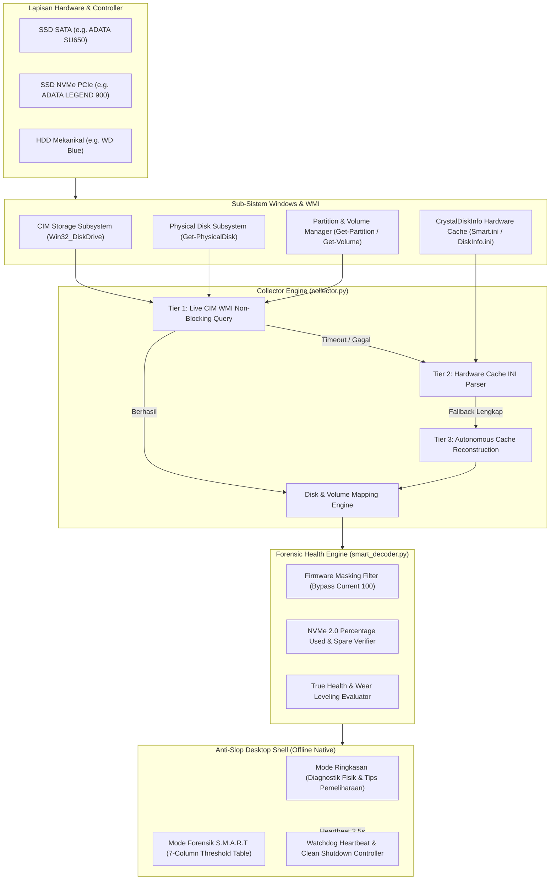

<p align="center">
  
</p>

<h1 align="center">DiagnoseMyDisk</h1>

<p align="center">
  <b>Inspektur Kesehatan Hardware Penyimpanan, Forensik S.M.A.R.T Mendalam & Pembongkar Anomali Firmware untuk Windows</b>
</p>

<p align="center">
  <a href="https://github.com/geadalfa/DiagnoseMyDisk/releases"></a>
  <a href="https://microsoft.com/windows"></a>
  <a href="https://python.org"></a>
  <a href="README.md"></a>
  <a href="README.md"></a>
  <a href="README.md"></a>
  <a href="LICENSE"></a>
</p>

---

> **DiagnoseMyDisk** adalah utilitas desktop diagnostik hardware penyimpanan tingkat lanjut untuk Windows 10 & 11. Aplikasi ini membongkar manipulasi pelaporan firmware (*False 100% masking*), menghitung persentase kesehatan fisik sebenarnya (*True Health*) pada SSD NVMe, SSD SATA, dan HDD mekanikal, memindai **Bad Sector** permukaan piringan/sel secara visual (*Surface LBA Map*), memulihkan sistem file & mengoptimasi sel NAND (*Drive Doctor*), serta menyajikan telemetri S.M.A.R.T lengkap melalui antarmuka desktop berstandar **Anti-Slop Zinc Modern** dalam mode terang maupun gelap.

---

---

## 📥 Unduh & Pasang Sekarang (Download & Install)

Tersedia versi siap pakai untuk Windows 10 & 11 (64-bit):

| Paket Rilis | Deskripsi | Tautan Unduhan Langsung |
| :--- | :--- | :--- |
| **Windows Installer Setup** *(Rekomendasi)* | Pemasangan otomatis ke sistem lokal, pembuatan shortcut desktop & start menu. Tanpa hak akses Administrator. | [**Unduh DiagnoseMyDisk_Setup.exe**](https://github.com/geadalfa/DiagnoseMyDisk/releases/download/v1.4.1/DiagnoseMyDisk_Setup.exe) |
| **Versi Portabel (.ZIP)** | Format portabel mandiri tanpa instalasi. Cukup ekstrak dan jalankan DiagnoseMyDisk.exe. | [**Unduh DiagnoseMyDisk-v1.4.1-portable.zip**](https://github.com/geadalfa/DiagnoseMyDisk/releases/download/v1.4.1/DiagnoseMyDisk-v1.4.1-portable.zip) |

Seluruh rilis lengkap dan catatan perubahan dapat diakses di [GitHub Releases](https://github.com/geadalfa/DiagnoseMyDisk/releases).

## 🌟 Master Architectural Feature Matrix

| Kategori | Fitur & Kapabilitas | Sub-Sistem / Engine | Invarian & Standar Teknis | Status |
| :--- | :--- | :--- | :--- | :---: |
| **Surface & Repair** | **Bad Sector Surface LBA Map** | ackend/scanner.py & UI | Memindai 200 blok fisik drive secara non-destruktif dengan sector-aligned I/O (kelipatan 512 bytes), mengukur latensi milidetik (ms) dan memetakan blok sehat, lemah, hingga bad sector. | ✅ ACTIVE |
| | **Drive Doctor (CHKDSK & TRIM)** | ackend/scanner.py & UI | Memicu perbaikan cluster & metadata volume Windows (Repair-Volume), optimasi sel flash NAND (ReTrim), serta audit status Dirty Bit. | ✅ ACTIVE |
| **Kalkulasi Kesehatan** | **Unmasking Firmware False 100%** | `backend/smart_decoder.py` | Mengabaikan kolom `Current` firmware statis; menghitung degradasi riil dari register mentah `0xA9`, relokasi `0x05`, dan bad block `0xA6`. | ✅ `ACTIVE` |
| | **NVMe 2.0 True Health Engine** | `backend/smart_decoder.py` | Kepatuhan NVM Express 2.0 Log Page 02h: memvalidasi `Percentage Used` vs `Available Spare` & `Media Integrity Errors`. | ✅ `ACTIVE` |
| | **Write Amplification (WAF)** | `backend/smart_decoder.py` | Rasio akumulasi penulisan data host terhadap penulisan fisik sel NAND (`HostWrites` vs `NandWrites`). | ✅ `ACTIVE` |
| **Akuisisi Telemetri** | **Multi-Tier Telemetry Cascade** | `backend/collector.py` | **Tier 1:** Live CIM WMI non-blocking (`Win32_DiskDrive`, `Get-PhysicalDisk`).<br>**Tier 2:** Hardware Cache fallback (`Smart.ini` & CDI database).<br>**Tier 3:** Deterministic Cache Reconstruction (instan 0.01 detik). | ✅ `ACTIVE` |
| | **Zero Blank Screen Guarantee** | `backend/collector.py` | Mencegah tampilan disk kosong (`[]`); jika WMI timeout/restricted, sistem otomatis merekonstruksi profil disk dari cache lokal. | ✅ `ACTIVE` |
| | **Pemetaan Partisi & Volume Otomatis** | `backend/collector.py` | Menghubungkan setiap drive fisik ke drive letter aktif (`C:`, `D:`, `E:`, `F:`, `I:`) dengan kalkulasi kapasitas real-time. | ✅ `ACTIVE` |
| **Runtime & Performa** | **100% Zero-CDN Offline Native** | `static/` | Tailwind CSS dan Lucide Icons dibundel lokal (`tailwind.min.js`, `lucide.min.js`). Berjalan 100% tanpa internet. | ✅ `ACTIVE` |
| | **Koneksi IPv4 Instan** | `server.py` | Mengikat socket ke `127.0.0.1:5550` langsung; mengeliminasi latensi negosiasi IPv6 `[::1]` pada Windows. | ✅ `ACTIVE` |
| | **Watchdog & Clean Auto-Shutdown** | `server.py` & `static/app.js` | Heartbeat 2.5s + `navigator.sendBeacon('/api/shutdown')`. Bebas dari *ghost background processes*. | ✅ `ACTIVE` |
| **UI/UX & Desain** | **Anti-Slop Desktop Shell** | `static/index.html` & `style.css` | Viewport desktop terkunci (`h-screen overflow-hidden`), palet warna Zinc netral (OKLCH), angka tabular (`tabular-nums`). | ✅ `ACTIVE` |
| | **Tabel Forensik S.M.A.R.T 7-Kolom** | `static/app.js` | Menampilkan Kondisi (3D spheres), Hex ID, Nama Atribut, Current, Worst, Ambang Batas Pabrikan (*Threshold*), dan Raw Hex/Dec. | ✅ `ACTIVE` |
| | **Dukungan Bilingual Instan (ID / EN)** | `static/app.js` | Beralih bahasa secara real-time dalam satu klik tanpa refresh halaman. | ✅ `ACTIVE` |

---

## ⚠️ Masalah Nyata vs. Solusi DiagnoseMyDisk

| Tantangan & Masalah Lapangan | Pendekatan Aplikasi Diagnostik Standar | Solusi Rekayasa DiagnoseMyDisk | Dampak & Nilai Nyata |
| :--- | :--- | :--- | :--- |
| **Bias Normalisasi Firmware (*False 100% Good*)** | Membaca kolom `Current` mentah-mentah. Controller mengunci nilai di `100`, sehingga aplikasi tetap menampilkan "100% Good" meski SSD hampir tewas. | **Algoritma True Health Deterministik**: Membedah register vendor raw (`0xA9`, `0x05`, `0xA6`, `0xE8`), membandingkan jam terbang dan cadangan blok flash NAND. | Pengguna mengetahui kondisi SSD sebenarnya sebelum data penting lenyap mendadak. |
| **Hilangnya S.M.A.R.T Tanpa Hak Akses Admin** | Gagal mengekstrak atribut WMI saat aplikasi dijalankan oleh akun pengguna biasa tanpa hak Administrator. Tabel S.M.A.R.T menjadi kosong. | **Multi-Tier Telemetry Cascade & Cache Reconstruction**: Membaca WMI non-blocking di Tier 1, lalu fallback otomatis ke cache hardware sistem lokal di Tier 2 & 3. | Aplikasi dapat dijalankan oleh siapa pun tanpa harus selalu klik kanan *"Run as Administrator"*. |
| **Aplikasi Desktop Macet Akibat Ketergantungan CDN** | Menggunakan script CDN eksternal (`unpkg.com`, `cdn.tailwindcss.com`). Jika internet putus atau lambat, UI rusak total dan aplikasi crash. | **Zero-CDN Offline Bundling**: Seluruh aset script visual, ikon, dan styling tersimpan lokal di dalam biner aplikasi. | Aplikasi dapat dibuka kapan pun, di mana pun, bahkan saat komputer dalam kondisi *Air-Gapped* / Offline. |
| **Proses Hantu (*Ghost Background Processes*)** | Server lokal tetap berjalan diam-diam setelah jendela ditutup, memakan RAM dan mengunci port 5550 secara permanen. | **Watchdog Heartbeat & Graceful Shutdown**: Frontend mengirim heartbeat berkala; server otomatis melakukan *exit clean* begitu jendela ditutup. | Bersih tanpa sisa proses di Task Manager, tidak boros memori dan baterai. |

---

## 🏛️ Alur Arsitektur Telemetri (Architecture Flow)



---

## 🔬 Anatomi Kasus: Membongkar Firmware Masking ADATA SU650

Sebagai bukti konkret pentingnya algoritma **True Health**, perhatikan perbedaan evaluasi pada SSD **ADATA SU650 (223.6 GB)** berikut:

```text
[Alat Diagnosa Konvensional]
  Status Kesehatan : 100% GOOD (Terkunci oleh Firmware)
  Keterangan       : Normal, Tidak Ada Masalah

[DiagnoseMyDisk True Health Engine]
  Status Kesehatan : 85% (Perlu Pantauan Ketat)
  Anomali Firmware : TERDETEKSI (Current Value Statis Terkunci di 100)
  Fakta Hardware Sebenarnya:
    • Register 0xA9 (Remaining Life Raw) : 0x59 (89% sisa ketahanan sel NAND)
    • Register 0x05 (Reallocated Sectors): 32 sektor rusak telah dipindahkan ke spare pool
    • Register 0xA6 (Total Bad Blocks)   : 170 bad block telah diisolasi oleh controller
    • Register 0xE8 (Available Reserve)  : Sisa blok cadangan menyusut ke 91%
    • Total Jam Terbang                  : 17,243 Jam (~2.0 tahun operasional kontinu)
    • Host Data Written                  : 39.9 TB (Beban tulis mendekati batas TBW kelas 240GB)
```

---

## 📁 Struktur Direktori Repositori

```text
DiagnoseMyDisk/
├── backend/
│   ├── __init__.py           # Package initializer
│   ├── collector.py          # Multi-tier telemetry collector (WMI + Hardware Cache + Auto-Reconstruction)
│   └── smart_decoder.py      # S.M.A.R.T raw register decoder, thresholds & True Health engine
├── static/
│   ├── app.js                # Anti-slop reactive frontend controller, safe icon handler & bilingual i18n
│   ├── index.html            # Contained desktop shell layout (Zinc palette, high information density)
│   ├── style.css             # Neutral Zinc design tokens (OKLCH), 3D spheres, custom scrollbars
│   ├── lucide.min.js         # Offline bundled vector iconography (Zero external CDN)
│   ├── tailwind.min.js       # Offline bundled reactive styling engine (Zero external CDN)
│   ├── manifest.json         # PWA Manifest for Windows taskbar icon
│   ├── favicon.ico           # Application icon
│   └── icon-*.png            # High-resolution raster icons (16px, 32px, 192px, 512px)
├── app_icon.ico              # Windows PE executable icon
├── DiagnoseMyDisk.spec       # PyInstaller build specification (Clean standalone bundle)
├── installer.iss             # Inno Setup Windows installer script
├── server.py                 # Multi-threaded server, IPv4 direct routing, watchdog & auto-shutdown
├── run.bat                   # Quick development launcher
├── requirements.txt          # Python dependencies
├── LICENSE                   # Creative Commons Attribution-NonCommercial 4.0 (CC BY-NC 4.0)
└── README.md                 # Dokumentasi teknis terpadu
```

---

## 🚀 Panduan Menjalankan & Build

### 1. Menjalankan Langsung dari Source Code (Development)

Pastikan Python 3.9+ telah terpasang di sistem Windows Anda:

```powershell
# 1. Clone repository
git clone https://github.com/geadalfa/DiagnoseMyDisk.git
cd DiagnoseMyDisk

# 2. Install dependensi
pip install -r requirements.txt

# 3. Jalankan server lokal
python server.py
# atau jalankan via launcher: .\run.bat
```
*Jendela aplikasi native desktop akan terbuka secara otomatis.*

### 2. Melakukan Kompilasi Biner Executable (.EXE)

Aplikasi dapat dikompilasi menjadi satu folder aplikasi mandiri (*standalone onedir*) menggunakan **PyInstaller**:

```powershell
# Kompilasi aplikasi mandiri
pyinstaller -y --clean DiagnoseMyDisk.spec
```
*Hasil build executable akan berada di direktori `dist/DiagnoseMyDisk/DiagnoseMyDisk.exe`.*

### 3. Membuat File Installer Setup Windows (.EXE)

Jika Anda memiliki **Inno Setup 6**, Anda dapat membuat file installer profesional:

```powershell
# Buka file installer.iss dengan Inno Setup Compiler atau jalankan via CLI:
iscc installer.iss
```
*File installer setup mandiri `DiagnoseMyDisk_Setup.exe` akan tersimpan di direktori `installer_output/`.*

---

## 🎨 Standar Desain Anti-Slop UI/UX

DiagnoseMyDisk dibangun dengan mematuhi prinsip **Anti-Slop Software Engineering**:
* **No Center-Aligned Everything:** Informasi disusun menggunakan grid 12-kolom dan kontainer bento terstruktur dengan batas maksimal lebar `max-w-[1400px]`.
* **Zero Artificial Gradients:** Dilarang menggunakan gradien ungu/indigo/pink murahan. Menggunakan palet **Zinc** netral bergradasi terang/gelap dengan kontras WCAG AAA.
* **Fixed Desktop Shell:** Layar desktop terkunci di `h-screen overflow-hidden`. Konten utama memiliki area scroll tersendiri, mencegah window bergoyang atau melar secara tak beraturan.
* **Typographic Stability:** Seluruh angka telemetri, suhu, sisa persentase, dan alamat register menggunakan `tabular-nums` dan font monospace agar tata letak tidak bergeser saat nilai ter-update secara real-time.
* **Zero Emojis in Controls:** Tombol navigasi dan toolbar hanya menggunakan ikon vektor SVG presisi dari Lucide Icons.

---

## 📄 Lisensi & Hak Cipta

Didistribusikan di bawah lisensi **Creative Commons Attribution-NonCommercial 4.0 International (CC BY-NC 4.0)**.

* **Non-Commercial:** Bebas digunakan, dipelajari, dimodifikasi, dan diaudit untuk keperluan pribadi, laboratorium, atau riset edukasi hardware. Dilarang keras diperjualbelikan atau dikomersialisasi ulang tanpa izin tertulis.
* **Attribution:** Hak Cipta dan rekayasa arsitektur oleh **Alfa ([@geadalfa](https://github.com/geadalfa)) & Gemi**.
