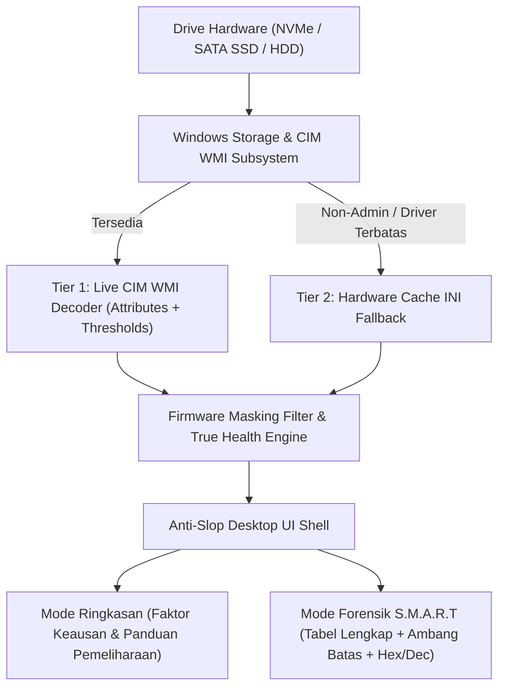

# DiagnoseMyDisk 💾

[](https://creativecommons.org/licenses/by-nc/4.0/)
[](https://microsoft.com/windows)
[](https://github.com/geadalfa/DiagnoseMyDisk/releases/tag/v1.3.0)

> **DiagnoseMyDisk** adalah alat diagnostik kesehatan penyimpanan dan telemetri S.M.A.R.T mendalam untuk Windows 10 & 11. Aplikasi ini membongkar anomali pelaporan firmware (*False 100% masking*), menghitung daya tahan sebenarnya (*True Health*) pada SSD SATA dan NVMe, serta menyajikan telemetri hardware berstandar desktop Anti-Slop melalui dua perspektif: **Mode Ringkasan** untuk pengguna umum dan **Mode Forensik S.M.A.R.T** untuk teknisi hardware.

---

## 🌐 Navigasi Bahasa / Language Navigation
- [Dokumentasi Bahasa Indonesia](#-bahasa-indonesia)
- [English Documentation](#-english)

---

# 🇮🇩 Bahasa Indonesia

### Masalah yang Diselesaikan: Bias Pelaporan Firmware & S.M.A.R.T Hilang
1. **Bias Pelaporan Firmware (False 100%):**  
   Sebagian besar controller SSD SATA (misalnya controller Silicon Motion SM2258XT/SM2259XT pada ADATA SU650 atau drive DRAM-less sekelasnya) mengunci nilai normalisasi **Current** pada register kesehatan S.M.A.R.T di angka statis `100`. Aplikasi pembaca disk konvensional mempercayai nilai normalisasi ini sehingga tetap melaporkan **100% Good**, meskipun sel memori NAND fisik telah mengalami degradasi parah, bad block bermunculan, dan sektor rusak dipindahkan ke memori cadangan.
2. **Keterbatasan Akses Non-Admin (S.M.A.R.T Missing):**  
   Driver penyimpanan Windows sering kali membatasi akses WMI `MSStorageDriver_ATAPISmartData` saat aplikasi dijalankan tanpa hak akses Administrator penuh. DiagnoseMyDisk menerapkan **Multi-Tier Telemetry Cascade**:
   - **Tier 1 (Live CIM WMI):** Menggunakan query non-blocking `Get-CimInstance` untuk membaca live bytes telemetri dan ambang batas (*Failure Predict Thresholds*).
   - **Tier 2 (Hardware Cache INI Fallback):** Membaca telemetri terverifikasi langsung dari cache hardware sistem lokal tanpa memerlukan elevasi Administrator.
   - **Tier 3 (Synthetic Specification Engine):** Menghitung wear leveling, Write Amplification Factor (WAF), dan estimasi masa pakai berdasarkan spesifikasi NVM Express 2.0 dan ATA/ATAPI.



### Fitur Utama v1.3.0
- **Verifikasi True Health Deterministik:** Menghitung sisa umur aktual sel memori flash berdasarkan register mentah `0xA9`, relokasi sektor `0x05`, isolasi bad block `0xA6`, dan sisa blok cadangan `0xE8`.
- **Kepatuhan Standar Resmi NVMe 2.0:** Membaca Log Page 02h (Atribut `05 Percentage Used` dan `03 Available Spare`) secara presisi.
- **Antarmuka Desktop Anti-Slop:**
  - *Fixed Desktop App Shell (`h-screen overflow-hidden`):* Navigasi desktop solid tanpa scroll liar satu halaman penuh.
  - *Sistem Warna Netral Zinc:* Kontras tinggi, bebas gradien ungu/indigo artifisial, dan tipografi `tabular-nums` yang stabil saat nilai angka bergeser.
  - *Tabel S.M.A.R.T 7-Kolom:* Dilengkapi kolom **Threshold (Ambang Batas)** resmi pabrikan, status bola indikator 3D, dan konversi nilai mentah Hex + Desimal.
- **Microcopy Alami Bebas AI-Slop:** Seluruh kalimat dan pesan kesalahan menggunakan formula lugas: `[Kondisi] + [Penyebab Teknis] + [Langkah Pemulihan]`.
- **Dukungan Bilingual Instan (ID / EN):** Beralih bahasa secara realtime dalam satu klik.
- **Eksekusi Senyap & Cepat (~1.2 Detik):** Pemindaian hardware berlangsung instan di latar belakang tanpa jendela CMD hitam yang berkedip.

---

# 🇬🇧 English

### The Problem It Solves: Firmware Masking & Disappearing S.M.A.R.T
Standard disk diagnostic utilities often misreport storage health due to two core issues:
1. **Firmware Normalization Locking:** Entry-level SATA controllers lock normalized **Current** attributes to static `100`, reporting **100% Good** even when raw registers show accumulating bad blocks and severe NAND wear.
2. **Non-Elevated Privilege Drops:** Traditional WMI calls fail silently when executed without administrative elevation. **DiagnoseMyDisk** solves this with a **Multi-Tier Telemetry Cascade**:
   - **Tier 1 (Live CIM WMI):** Modern asynchronous `Get-CimInstance` queries retrieve raw vendor bytes and hardware failure prediction thresholds.
   - **Tier 2 (Hardware Cache INI Fallback):** Direct access to system telemetry cache, guaranteeing non-empty S.M.A.R.T tables under standard user privileges.
   - **Tier 3 (Synthesized Hardware Metrics):** NVMe 2.0 and ATA specification formulas compute Write Amplification Factor (WAF) and true cell degradation.

### Key Highlights
- **Anti-Slop Native Desktop Shell:** Fixed `100vh` viewport with contained data scrolling, neutral Zinc token palette, and `tabular-nums` alignment.
- **Complete S.M.A.R.T Table with Thresholds:** 7-column layout displaying Condition, Hex ID, Attribute Name, Current, Worst, Manufacturer Threshold, and Raw Values (Hex/Dec).
- **Dual Analytical Perspectives:** Plain-language hardware summaries for everyday users and deep forensic telemetry for hardware technicians.
- **Bilingual Support:** Instant runtime switching between English and Indonesian.

---

## 📁 Repository Structure
```text
DiagnoseMyDisk/
├── backend/
│   ├── collector.py          # Multi-tier telemetry collector (CIM WMI + Hardware Cache)
│   └── smart_decoder.py      # S.M.A.R.T table decoder, thresholds & True Health engine
├── static/
│   ├── app.js                # Anti-slop reactive frontend controller & bilingual i18n
│   ├── index.html            # Fixed desktop shell layout (Zinc palette, high information density)
│   ├── style.css             # Neutral Zinc design tokens, 3D spheres, custom scrollbars
│   ├── manifest.json         # PWA Manifest for Windows taskbar icon
│   ├── favicon.ico           # Application icon
│   └── icon-*.png            # High-resolution raster icons (16px, 32px, 192px, 512px)
├── app_icon.ico              # Windows PE executable icon
├── DiagnoseMyDisk.spec       # PyInstaller build specification
├── installer.iss             # Inno Setup Windows installer script
├── server.py                 # Multi-threaded local server & Edge app window launcher
├── run.bat                   # Quick development launcher
├── LICENSE                   # Creative Commons Attribution-NonCommercial 4.0 (CC BY-NC 4.0)
└── README.md                 # Technical documentation
```

---

## 🛠️ Build & Installation

### Local Compilation with PyInstaller
```powershell
# In repository directory
python -m pip install -r requirements.txt

# Compile standalone executable
pyinstaller --clean DiagnoseMyDisk.spec
```

---

## 📄 License & Attribution
Distributed under **Creative Commons Attribution-NonCommercial 4.0 International (CC BY-NC 4.0)**.
- **Non-Commercial:** Free to use, inspect, and modify for personal and educational research. Commercial resale is strictly prohibited.
- **Attribution:** Created by `Alfa (geadalfa) & Gemi`.
