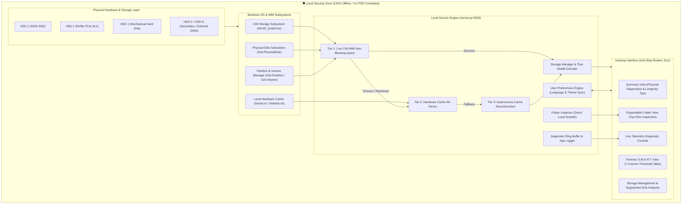
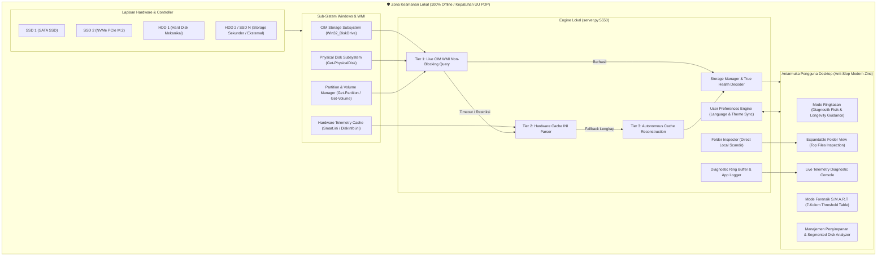

<p align="center">
  
</p>

<h1 align="center">DiagnoseMyDisk</h1>

<p align="center">
  <b>Storage Hardware Diagnostics, S.M.A.R.T Forensic Telemetry & Firmware Anomaly Unmasker for Windows</b>
</p>

<p align="center">
  <b><a href="#diagnosemydisk">🇬🇧 English (Top)</a> &nbsp;|&nbsp; <a href="#-dokumentasi-bahasa-indonesia">🇮🇩 Bahasa Indonesia (Bawah)</a></b>
</p>

<p align="center">
  <a href="https://github.com/geadalfa/DiagnoseMyDisk/releases"></a>
  <a href="https://microsoft.com/windows"></a>
  <a href="https://python.org"></a>
  <a href="#-privacy-guarantee-we-do-not-collect-data"></a>
  <a href="#-privacy-guarantee-we-do-not-collect-data"></a>
  <a href="LICENSE"></a>
</p>

---

> [!IMPORTANT]
> ### 🛡️ Privacy Guarantee: "WE DO NOT COLLECT DATA"
> **DiagnoseMyDisk enforces complete data sovereignty and complies with Republic of Indonesia Law No. 27 of 2022 on Personal Data Protection (UU PDP) and international privacy standards:**
>
> 1. **100% Offline & Zero Telemetry:** The application binds strictly to the local loopback interface (`127.0.0.1:5550`). It contains no analytics beacons, no tracking pixels, no third-party telemetry libraries, and no outbound network calls.
> 2. **Complete Data Sovereignty:** DiagnoseMyDisk never accesses, reads, or transmits personal documents, files, browser histories, or credentials. Storage scanning inspects only file size attributes and directory structures required to calculate disk allocations.
> 3. **Auditable Open Source:** The entire source code is public and un-obfuscated. Independent security researchers, developers, and end users can inspect the code to verify that zero bytes of personal data ever leave your machine.

---

> **DiagnoseMyDisk** is an advanced Windows storage diagnostic and disk management utility for Windows 10 & 11. It unmasks manufacturer firmware normalization (*False 100% Good* reports), evaluates physical hardware degradation (*True Health*) across NVMe, SATA SSDs, and mechanical HDDs, maps storage block degradation (*Surface LBA Map*), repairs file system volumes (*Drive Doctor*), provides segmented capacity analysis (*PC Manager Style*), identifies duplicate files via *SHA-256*, and offers **Interactive Folder Inspection** and **Live Diagnostic Logging** through a high-contrast **Anti-Slop Zinc** desktop interface.

---

## Download & Install (v2.1.1)

Standalone executables for Windows 10 & 11 (64-bit):

| Distribution Package | Description | Direct Download |
| :--- | :--- | :--- |
| **Windows Installer (.EXE)** *(Recommended)* | Automated installation to local AppData, desktop and start menu shortcuts. Does not require Administrator privileges. | [**Download DiagnoseMyDisk_Setup.exe (v2.1.1)**](https://github.com/geadalfa/DiagnoseMyDisk/releases/download/v2.1.1/DiagnoseMyDisk_Setup.exe) |
| **Portable Archive (.ZIP)** | Standalone portable bundle. Extract and run `DiagnoseMyDisk.exe` without installation. | [**Download DiagnoseMyDisk-v2.1.1-portable.zip**](https://github.com/geadalfa/DiagnoseMyDisk/releases/download/v2.1.1/DiagnoseMyDisk-v2.1.1-portable.zip) |

All official releases and commit histories are accessible on [GitHub Releases](https://github.com/geadalfa/DiagnoseMyDisk/releases).

---

## Master Architectural Feature Matrix

| Category | Capability | Subsystem | Technical Specifications | Status |
| :--- | :--- | :--- | :--- | :---: |
| **Folder Inspection** | **Interactive Folder Expansion** *(v2.1.0)* | `backend/storage_manager.py` & UI | Click on any recommended folder (GPU Cache, Downloads, Browser Cache, Large Folders) to reveal its contents directly in the UI, sorted by file size descending, with modification dates and direct Explorer shortcuts. | ✅ `ACTIVE` |
| **Preferences & i18n** | **Default English & Dual-Tier Persistence** *(v2.1.1)* | `server.py` & `static/app.js` | Defaults to English on fresh profile initialization. Persists language selections across sessions using instant synchronous `localStorage` and durable server profile storage (`user_preferences.json`). | ✅ `ACTIVE` |
| **Diagnostic Logging** | **Live Telemetry & Diagnostic Console** | `backend/app_logger.py` & UI | Dual logging engine: persistent file logging (`diagnose_my_disk.log`) and 1000-line in-memory ring buffer with live polling, clipboard copy, and direct Notepad launch. | ✅ `ACTIVE` |
| **Storage Allocation** | **Segmented Storage Analyzer** | `backend/storage_manager.py` & UI | PC Manager-style segmented bar representing capacity distribution: User Files, Applications, Windows System, Recycle Bin, and Other/Caches. | ✅ `ACTIVE` |
| | **Two-Tier Duplicate File Detection** | `backend/storage_manager.py` | Tier 1: exact file size matching and 4KB MD5 header hash; Tier 2: full SHA-256 verification with automatic exclusion of protected system directories (`WindowsApps`, `C:\Windows`). | ✅ `ACTIVE` |
| | **Smart Cleanup Recommendations** | `backend/storage_manager.py` | Detects non-essential data safely: DirectX shader cache, driver update artifacts, package manager caches (`uv`, `pip`, `npm`), browser caches (`Chrome`, `Edge`), and Windows Temp. | ✅ `ACTIVE` |
| **Surface & Repair** | **Bad Sector Surface LBA Map** | `backend/scanner.py` & UI | Non-destructive scanning of 200 physical disk blocks with 512-byte sector-aligned I/O, latency benchmarking (ms), and visual health classification. | ✅ `ACTIVE` |
| | **Drive Doctor (CHKDSK & TRIM)** | `backend/scanner.py` & UI | Dispatches Windows volume metadata verification (`Repair-Volume`), NAND cell maintenance (`ReTrim`), and Dirty Bit evaluation. | ✅ `ACTIVE` |
| **Health Analytics** | **Firmware Masking Filter** | `backend/smart_decoder.py` | Ignores static manufacturer `Current 100` readings. Computes wear directly from vendor registers (`0xA9`, `0x05`, `0xA6`, `0xE8`). | ✅ `ACTIVE` |
| | **NVMe 2.0 True Health Engine** | `backend/smart_decoder.py` | Complies with NVM Express 2.0 Log Page 02h: evaluates `Percentage Used`, `Available Spare`, and `Media Integrity Errors`. | ✅ `ACTIVE` |
| | **Write Amplification (WAF)** | `backend/smart_decoder.py` | Calculates ratio of host data writes against physical NAND cell writes (`HostWrites` vs `NandWrites`). | ✅ `ACTIVE` |
| **Telemetry Cascade** | **Multi-Tier Collector** | `backend/collector.py` | **Tier 1:** Live non-blocking CIM WMI query.<br>**Tier 2:** Hardware cache parser (`Smart.ini` / CDI database).<br>**Tier 3:** Deterministic local cache reconstruction (0.01s). | ✅ `ACTIVE` |
| | **Zero Blank Screen Guarantee** | `backend/collector.py` | Ensures drive listings are never blank. If WMI queries time out, system reconstructs drive profiles from local hardware cache. | ✅ `ACTIVE` |
| | **Partition & Drive Letter Mapping** | `backend/collector.py` | Automatically associates physical storage devices with logical drive letters (`C:`, `D:`, `E:`, ... Drive N) with real-time capacity checks. | ✅ `ACTIVE` |
| **Runtime & Network** | **Zero-CDN Offline Operation** | `static/` | Tailwind CSS and Lucide vector icons are bundled locally (`tailwind.min.js`, `lucide.min.js`). Operates completely without internet access. | ✅ `ACTIVE` |
| | **Direct IPv4 Socket** | `server.py` | Binds directly to `127.0.0.1:5550`, eliminating Windows IPv6 `[::1]` resolution latency. | ✅ `ACTIVE` |
| | **Watchdog & Clean Auto-Shutdown** | `server.py` & `static/app.js` | Heartbeat polling (2.5s) and `navigator.sendBeacon('/api/shutdown')` ensure the backend exits cleanly when the desktop window closes. | ✅ `ACTIVE` |
| **UI/UX Design** | **Anti-Slop Desktop Shell** | `static/index.html` & `style.css` | Fixed desktop viewport (`h-screen overflow-hidden`), neutral Zinc design tokens (OKLCH), tabular numeric alignment (`tabular-nums`), high-contrast dark mode. | ✅ `ACTIVE` |
| | **7-Column Forensic S.M.A.R.T Table** | `static/app.js` | Displays Condition (3D spheres), Hex ID, Attribute Name, Current, Worst, Manufacturer Threshold, and Raw Hex/Dec values. | ✅ `ACTIVE` |
| | **Instant Bilingual Switching (EN / ID)** | `static/app.js` | Real-time language switching without page reloads or interface flashes. | ✅ `ACTIVE` |

---

## Real-World Problems vs. DiagnoseMyDisk Solutions

| Industry Challenge | Standard Diagnostic Utility Approach | DiagnoseMyDisk Solution | Practical Impact |
| :--- | :--- | :--- | :--- |
| **Privacy Invasions & Telemetry Uploads** | Sends directory listings, hardware identifiers, and telemetry data to external cloud servers. | **100% Offline & UU PDP Compliance**: Zero external socket traffic. Operates strictly on `127.0.0.1:5550`. | Absolute data privacy. Safe for air-gapped workstations and confidential business environments. |
| **Firmware Normalization (*False 100% Good*)** | Reads raw `Current` values without validation. Controller locks reading at `100`, reporting a healthy drive while flash cells degrade. | **Deterministic True Health Engine**: Decodes raw registers (`0xA9`, `0x05`, `0xA6`, `0xE8`) to measure genuine wear and spare block exhaustion. | Users receive early warning before data loss occurs on failing drives. |
| **Slow Folder Inspection in External Explorers** | Forces users to open Windows Explorer repeatedly to inspect directories before deciding whether to clean them. | **Interactive Folder Expansion**: Single-click accordion expansion reveals the largest files inside any directory within the UI. | Eliminates workflow disruption and accelerates disk cleanup decisions. |
| **Empty S.M.A.R.T Tables Without Admin Rights** | Fails to query WMI interfaces when executed from standard user accounts, presenting empty tables. | **Multi-Tier Cascade & Cache Reconstruction**: Queries WMI non-blocking in Tier 1, then falls back automatically to local system hardware cache in Tiers 2 and 3. | Runs reliably under standard user accounts without requiring administrative elevation for basic telemetry. |
| **Desktop Freezes from External CDN Latency** | Relies on external CDN scripts (`unpkg.com`, `tailwindcss.com`). Network timeouts cause UI stalls and crashes. | **Zero-CDN Bundling**: All scripts, styling assets, and vector icons are embedded directly in the distribution binary. | Guaranteed startup and interface rendering regardless of network state. |
| **Ghost Background Processes** | Server continues running in the background after closing the app window, consuming memory and locking ports. | **Watchdog Heartbeat & Graceful Shutdown**: Frontend transmits periodic heartbeats; backend terminates cleanly when the window is closed. | Zero orphaned processes in Windows Task Manager; prevents port conflicts and background battery drain. |

---

## System Architecture



---

## Forensic Case Study: Bypassing Firmware Normalization (Sample SSD 1)

The difference between standard utility readings and the **True Health** engine is demonstrated in this test of a **Sample 240 GB SATA SSD (SSD 1)**:

```text
[Conventional Diagnostic Utilities]
  Reported Status  : 100% GOOD (Static Controller Lock)
  Summary          : Normal, No Action Required

[DiagnoseMyDisk True Health Engine]
  Reported Status  : 85% (Requires Immediate Monitoring)
  Firmware Anomaly : DETECTED (Current value locked at 100 by manufacturer firmware)
  Underlying Hardware Reality:
    • Register 0xA9 (Remaining Life Raw) : 0x59 (89% remaining NAND cell endurance)
    • Register 0x05 (Reallocated Sectors): 32 bad sectors relocated to spare pool
    • Register 0xA6 (Total Bad Blocks)   : 170 bad blocks isolated by controller
    • Register 0xE8 (Available Reserve)  : Spare block reserve depleted to 91%
    • Power-On Hours                     : 17,243 Hours (~2.0 years of continuous operation)
    • Cumulative Host Writes             : 39.9 TB (Approaching total endurance threshold)
```

---

## Repository Directory Structure

```text
DiagnoseMyDisk/
├── backend/
│   ├── __init__.py           # Package initializer
│   ├── app_logger.py         # Dual logging engine (Persistent File + In-Memory Ring Buffer)
│   ├── collector.py          # Multi-tier telemetry collector (WMI + Hardware Cache + Reconstruction)
│   ├── hardware_profile.py   # Storage controller profiler & NAND flash architecture guide
│   ├── scanner.py            # Bad Sector surface LBA scanner & Drive Doctor repair
│   ├── smart_decoder.py      # S.M.A.R.T raw register decoder, thresholds & True Health engine
│   └── storage_manager.py    # Multi-drive storage analyzer, duplicate finder & interactive folder inspector
├── static/
│   ├── app.js                # Anti-slop frontend controller, bilingual i18n & folder expansion
│   ├── index.html            # Contained desktop shell layout (Zinc palette, high information density)
│   ├── style.css             # Neutral Zinc design tokens (OKLCH), 3D spheres, high-contrast dark mode
│   ├── lucide.min.js         # Offline bundled vector iconography (Zero external CDN)
│   ├── tailwind.min.js       # Offline bundled styling engine (Zero external CDN)
│   ├── manifest.json         # PWA Manifest for Windows taskbar icon
│   ├── favicon.ico           # Application icon
│   └── icon-*.png            # High-resolution raster icons (16px, 32px, 192px, 512px)
├── tests/
│   ├── test_server_routes.py # Integration QA test suite for HTTP API endpoints & preferences
│   └── test_storage_manager.py # Unit test suite for storage engine, duplicates & folder inspector
├── app_icon.ico              # Windows PE executable icon
├── DiagnoseMyDisk.spec       # PyInstaller build specification (Clean standalone bundle)
├── installer.iss             # Inno Setup Windows installer script (v2.1.1)
├── release.py                # Automated GitHub release & asset deployment runner
├── server.py                 # Multi-threaded server, IPv4 direct routing, watchdog & preferences
├── run.bat                   # Quick development launcher
├── requirements.txt          # Python dependencies
├── LICENSE                   # Creative Commons Attribution-NonCommercial 4.0 (CC BY-NC 4.0)
└── README.md                 # Complete documentation in English & Indonesian
```

---

## Development & Build Instructions

### 1. Running from Source

Prerequisites: Python 3.9+ on Windows:

```powershell
# 1. Clone repository
git clone https://github.com/geadalfa/DiagnoseMyDisk.git
cd DiagnoseMyDisk

# 2. Install dependencies
pip install -r requirements.txt

# 3. Launch local server
python server.py
# or execute the launcher: .\run.bat
```
*The native application window opens automatically via Microsoft Edge in application mode.*

### 2. Compiling Standalone Binary (.EXE)

To bundle the application into a standalone folder distribution using **PyInstaller**:

```powershell
pyinstaller -y --clean DiagnoseMyDisk.spec
```
*The compiled binary is generated at `dist/DiagnoseMyDisk/DiagnoseMyDisk.exe`.*

### 3. Building Windows Setup Installer (.EXE)

To compile the setup installer with **Inno Setup 6**:

```powershell
iscc installer.iss
```
*The installer package `DiagnoseMyDisk_Setup.exe` is placed in `installer_output/`.*

### 4. Running Unit & Integration Tests (QA Verification)

```powershell
python -m unittest discover tests
```
*All 15 test suites must pass with exit code 0.*

---

## Anti-Slop UI/UX Design Standards

DiagnoseMyDisk adheres strictly to **Anti-Slop Software Engineering** principles:
* **No Center-Aligned Everything:** Information is organized across structured 12-column grids and bento containers with a max width constraint of `max-w-[1400px]`.
* **Zero Artificial Gradients:** No purple/indigo marketing gradients. Uses a neutral **Zinc** scale with WCAG AAA verified contrast ratios.
* **Fixed Desktop Viewport:** Screen bounds locked to `h-screen overflow-hidden`. The main content area scrolls independently to eliminate window shifting.
* **Typographic Stability:** All telemetry metrics, temperatures, percentages, and register offsets utilize `tabular-nums` and monospace fonts to prevent layout jitter during real-time updates.
* **Zero Decorative Emojis in Controls:** Navigation bars and toolbars use SVG vector glyphs from Lucide Icons.

---

## License & Terms of Use (Open Source Non-Commercial)

Distributed under the **Creative Commons Attribution-NonCommercial 4.0 International (CC BY-NC 4.0)** license.

* 🌐 **Open Source & Transparent:** You are free to inspect, study, modify, and audit the source code for personal, educational, security research, and hardware diagnostic purposes.
* 🚫 **COMMERCIAL USE PROHIBITED:** This application and its derivative source code or binaries **MAY NOT** be sold, monetized, incorporated into commercial paid software, or distributed for fees without express written authorization from the author.
* ⚖️ **Statutory Privacy Compliance:** Complies fully with Republic of Indonesia Personal Data Protection Law (UU PDP No. 27/2022).
* 🏷️ **Attribution & Copyright:** Engineered and authored by **Alfa ([@geadalfa](https://github.com/geadalfa)) & Gemi**.

<br>

---
---

<br>

# 🇮🇩 Dokumentasi Bahasa Indonesia

<p align="center">
  <b><a href="#diagnosemydisk">⬆️ Kembali ke Versi Bahasa Inggris (Back to English)</a></b>
</p>

---

> [!IMPORTANT]
> ### 🛡️ Jaminan Privasi Mutlak: "KAMI TIDAK MENGAMBIL DATA"
> **DiagnoseMyDisk menjunjung tinggi kedaulatan data pengguna dan mematuhi sepenuhnya ketentuan Undang-Undang Republik Indonesia No. 27 Tahun 2022 tentang Perlindungan Data Pribadi (UU PDP) serta standar privasi global:**
>
> 1. **100% Offline & Zero-Telemetry:** Tidak ada *tracking*, tidak ada *analytics*, tidak ada skrip pihak ketiga, dan tidak ada pengiriman data ke server *cloud* mana pun. Aplikasi berkomunikasi secara eksklusif pada socket *loopback* lokal komputer Anda (`127.0.0.1:5550`).
> 2. **Data Anda Sepenuhnya Milik Anda:** DiagnoseMyDisk **TIDAK PERNAH** membaca, membuka, atau menyalin isi berkas pribadi, dokumen rahasia, riwayat peramban, maupun kredensial Anda. Pemindaian disk hanya membaca atribut ukuran berkas dan struktur direktori lokal untuk kalkulasi kuota ruang kosong.
> 3. **Transparansi Penuh & Terbuka untuk Audit (Open Source):** Seluruh kode sumber terbuka 100% tanpa ada modul tertutup atau *obfuscation*. Siapa pun, baik auditor keamanan, pengembang independen, maupun pengguna umum, dapat mengaudit kode program untuk membuktikan bahwa tidak ada satu byte pun data pribadi Anda yang keluar dari komputer Anda.

---

> **DiagnoseMyDisk** adalah utilitas desktop diagnostik hardware dan manajemen penyimpanan tingkat lanjut untuk Windows 10 & 11. Aplikasi ini membongkar manipulasi pelaporan firmware (*False 100% masking*), menghitung persentase kesehatan fisik sebenarnya (*True Health*) pada SSD NVMe, SSD SATA, dan HDD mekanikal, memindai **Bad Sector** permukaan piringan/sel secara visual (*Surface LBA Map*), memulihkan sistem file & mengoptimasi sel NAND (*Drive Doctor*), menyajikan analisis kuota disk gaya *Microsoft PC Manager*, mendeteksi berkas duplikat berbasis *SHA-256*, serta menyediakan **Inspeksi Isi Folder Interaktif** dan **Log Diagnostik Real-Time** melalui antarmuka desktop berstandar **Anti-Slop Zinc Modern**.

---

## Unduh & Pasang Sekarang (v2.1.1)

Tersedia versi siap pakai untuk Windows 10 & 11 (64-bit):

| Paket Rilis | Deskripsi | Tautan Unduhan Langsung |
| :--- | :--- | :--- |
| **Windows Installer Setup** *(Rekomendasi)* | Pemasangan otomatis ke sistem lokal, pembuatan shortcut desktop & start menu. Tanpa hak akses Administrator. | [**Unduh DiagnoseMyDisk_Setup.exe (v2.1.1)**](https://github.com/geadalfa/DiagnoseMyDisk/releases/download/v2.1.1/DiagnoseMyDisk_Setup.exe) |
| **Versi Portabel (.ZIP)** | Format portabel mandiri tanpa instalasi. Cukup ekstrak dan jalankan `DiagnoseMyDisk.exe`. | [**Unduh DiagnoseMyDisk-v2.1.1-portable.zip**](https://github.com/geadalfa/DiagnoseMyDisk/releases/download/v2.1.1/DiagnoseMyDisk-v2.1.1-portable.zip) |

Seluruh rilis lengkap dan catatan perubahan dapat diakses di [GitHub Releases](https://github.com/geadalfa/DiagnoseMyDisk/releases).

---

## Matriks Fitur & Arsitektur Utama (v2.1.1)

| Kategori | Fitur & Kapabilitas | Sub-Sistem / Engine | Invarian & Standar Teknis | Status |
| :--- | :--- | :--- | :--- | :---: |
| **Manajemen Folder** | **Inspeksi Folder Interaktif (Expand)** *(v2.1.0)* | `backend/storage_manager.py` & UI | Klik pada baris folder (GPU Cache, Downloads, Browser Cache, Folder Besar) untuk membuka daftar berkas di dalamnya secara instan (urut ukuran terbesar, tanggal modifikasi, shortcut buka Explorer). | ✅ `ACTIVE` |
| **Preferensi & Bahasa** | **Bahasa Inggris Default & Persistensi Dwibahasa** *(v2.1.1)* | `server.py` & `static/app.js` | Bahasa default adalah English pada sesi baru. Pilihan bahasa tersimpan otomatis ke `localStorage` dan disinkronkan ke profil server `user_preferences.json` untuk sesi berikutnya. | ✅ `ACTIVE` |
| **Logging & Telemetri** | **Log Diagnostik Live (AI & Human Console)** | `backend/app_logger.py` & UI | Perekaman ganda berkas log persisten (`diagnose_my_disk.log`) + *in-memory ring buffer* 1000 baris dengan live polling, copy to clipboard, dan buka instan di Notepad. | ✅ `ACTIVE` |
| **Penyimpanan & Kuota** | **Segmented Storage Analyzer (PC Manager Style)** | `backend/storage_manager.py` & UI | Visualisasi segmented bar kapasitas disk (Berkas Pengguna, Aplikasi, Sistem Windows, Recycle Bin, Lainnya/Cache) untuk semua drive atau per-drive. | ✅ `ACTIVE` |
| | **Deteksi Berkas Duplikat 2-Tier** | `backend/storage_manager.py` | Scanning duplikat cepat: Tier 1 verifikasi kesamaan ukuran + 4KB MD5 header, dilanjutkan Tier 2 hashing SHA-256 utuh dengan proteksi exclusion folder sistem WindowsApps. | ✅ `ACTIVE` |
| | **Rekomendasi Pembersihan Cerdas** | `backend/storage_manager.py` | Mendeteksi penumpukan aman: shader cache GPU, installer OTA driver, cache compiler (`uv`, `pip`, `npm`), peramban (`Chrome`, `Edge`), dan Windows Temp. | ✅ `ACTIVE` |
| **Surface & Repair** | **Bad Sector Surface LBA Map** | `backend/scanner.py` & UI | Memindai 200 blok fisik drive secara non-destruktif dengan sector-aligned I/O (kelipatan 512 bytes), mengukur latensi milidetik (ms) dan memetakan blok sehat, lemah, hingga bad sector. | ✅ `ACTIVE` |
| | **Drive Doctor (CHKDSK & TRIM)** | `backend/scanner.py` & UI | Memicu perbaikan cluster & metadata volume Windows (Repair-Volume), optimasi sel flash NAND (ReTrim), serta audit status Dirty Bit. | ✅ `ACTIVE` |
| **Kalkulasi Kesehatan** | **Unmasking Firmware False 100%** | `backend/smart_decoder.py` | Mengabaikan kolom `Current` firmware statis; menghitung degradasi riil dari register mentah `0xA9`, relokasi `0x05`, dan bad block `0xA6`. | ✅ `ACTIVE` |
| | **NVMe 2.0 True Health Engine** | `backend/smart_decoder.py` | Kepatuhan NVM Express 2.0 Log Page 02h: memvalidasi `Percentage Used` vs `Available Spare` & `Media Integrity Errors`. | ✅ `ACTIVE` |
| | **Write Amplification (WAF)** | `backend/smart_decoder.py` | Rasio akumulasi penulisan data host terhadap penulisan fisik sel NAND (`HostWrites` vs `NandWrites`). | ✅ `ACTIVE` |
| **Akuisisi Telemetri** | **Multi-Tier Telemetry Cascade** | `backend/collector.py` | **Tier 1:** Live CIM WMI non-blocking (`Win32_DiskDrive`, `Get-PhysicalDisk`).<br>**Tier 2:** Hardware Cache fallback (`Smart.ini` & CDI database).<br>**Tier 3:** Deterministic Cache Reconstruction (instan 0.01 detik). | ✅ `ACTIVE` |
| | **Zero Blank Screen Guarantee** | `backend/collector.py` | Mencegah tampilan disk kosong (`[]`); jika WMI timeout/restricted, sistem otomatis merekonstruksi profil disk dari cache lokal. | ✅ `ACTIVE` |
| | **Pemetaan Partisi & Volume Otomatis** | `backend/collector.py` | Menghubungkan setiap drive fisik ke drive letter aktif (`C:`, `D:`, `E:`, ... Drive N) dengan kalkulasi kapasitas real-time. | ✅ `ACTIVE` |
| **Runtime & Performa** | **100% Zero-CDN Offline Native** | `static/` | Tailwind CSS dan Lucide Icons dibundel lokal (`tailwind.min.js`, `lucide.min.js`). Berjalan 100% tanpa internet. | ✅ `ACTIVE` |
| | **Koneksi IPv4 Instan** | `server.py` | Mengikat socket ke `127.0.0.1:5550` langsung; mengeliminasi latensi negosiasi IPv6 `[::1]` pada Windows. | ✅ `ACTIVE` |
| | **Watchdog & Clean Auto-Shutdown** | `server.py` & `static/app.js` | Heartbeat 2.5s + `navigator.sendBeacon('/api/shutdown')`. Bebas dari *ghost background processes*. | ✅ `ACTIVE` |
| **UI/UX & Desain** | **Anti-Slop Desktop Shell** | `static/index.html` & `style.css` | Viewport desktop terkunci (`h-screen overflow-hidden`), palet warna Zinc netral (OKLCH), angka tabular (`tabular-nums`), mode gelap berdefinisi tinggi. | ✅ `ACTIVE` |
| | **Tabel Forensik S.M.A.R.T 7-Kolom** | `static/app.js` | Menampilkan Kondisi (3D spheres), Hex ID, Nama Atribut, Current, Worst, Ambang Batas Pabrikan (*Threshold*), dan Raw Hex/Dec. | ✅ `ACTIVE` |
| | **Dukungan Bilingual Instan (ID / EN)** | `static/app.js` | Beralih bahasa secara real-time dalam satu klik tanpa refresh halaman. | ✅ `ACTIVE` |

---

## Masalah Nyata vs. Solusi DiagnoseMyDisk

| Tantangan & Masalah Lapangan | Pendekatan Aplikasi Diagnostik Standar | Solusi Rekayasa DiagnoseMyDisk | Dampak & Nilai Nyata |
| :--- | :--- | :--- | :--- |
| **Pelanggaran Privasi & Upload Telemetri** | Mengirim riwayat file, nama direktori, dan data perangkat keras ke server analitik *cloud*. | **100% Offline & Kepatuhan UU PDP**: Nol transmisi jaringan luar, eksekusi eksklusif di localhost `127.0.0.1:5550`. | Privasi terjamin mutlak; aman digunakan di komputer pribadi, kantor, maupun institusi rahasia (*Air-Gapped*). |
| **Bias Normalisasi Firmware (*False 100% Good*)** | Membaca kolom `Current` mentah-mentah. Controller mengunci nilai di `100`, sehingga aplikasi tetap menampilkan "100% Good" meski SSD hampir rusak. | **Algoritma True Health Deterministik**: Membedah register vendor raw (`0xA9`, `0x05`, `0xA6`, `0xE8`), membandingkan jam terbang dan cadangan blok flash NAND. | Pengguna mengetahui kondisi SSD sebenarnya sebelum data penting hilang secara tiba-tiba. |
| **Inspeksi Folder Lambat & Membuka Banyak Jendela** | Mengharuskan pengguna bolak-balik membuka File Explorer secara manual untuk melihat isi folder cache/unduhan. | **Inspeksi Folder Interaktif**: Satu klik pada baris folder langsung membuka sub-daftar berkas terurut ukuran terbesar di dalam UI. | Menghemat waktu verifikasi sebelum melakukan penghapusan atau pembersihan ruang disk. |
| **Hilangnya S.M.A.R.T Tanpa Hak Akses Admin** | Gagal mengekstrak atribut WMI saat aplikasi dijalankan oleh akun pengguna biasa tanpa hak Administrator. Tabel S.M.A.R.T menjadi kosong. | **Multi-Tier Telemetry Cascade & Cache Reconstruction**: Membaca WMI non-blocking di Tier 1, lalu fallback otomatis ke cache hardware sistem lokal di Tier 2 & 3. | Aplikasi dapat dijalankan oleh siapa pun tanpa harus selalu klik kanan *"Run as Administrator"*. |
| **Aplikasi Desktop Macet Akibat Ketergantungan CDN** | Menggunakan script CDN eksternal (`unpkg.com`, `cdn.tailwindcss.com`). Jika internet putus atau lambat, UI rusak total dan aplikasi crash. | **Zero-CDN Offline Bundling**: Seluruh aset script visual, ikon, dan styling tersimpan lokal di dalam biner aplikasi. | Aplikasi dapat dibuka kapan pun, di mana pun, bahkan saat komputer tanpa koneksi internet. |
| **Proses Hantu (*Ghost Background Processes*)** | Server lokal tetap berjalan diam-diam setelah jendela ditutup, memakan RAM dan mengunci port 5550 secara permanen. | **Watchdog Heartbeat & Graceful Shutdown**: Frontend mengirim heartbeat berkala; server otomatis melakukan *exit clean* begitu jendela ditutup. | Bersih tanpa sisa proses di Task Manager, tidak boros memori dan baterai. |

---

## Alur Arsitektur Telemetri & Privasi



---

## Anatomi Kasus: Membongkar Firmware Masking (Contoh SSD 1)

Sebagai bukti konkret pentingnya algoritma **True Health**, perhatikan perbedaan evaluasi pada **Contoh SSD 1 (240 GB SATA SSD)** berikut:

```text
[Alat Diagnosa Konvensional]
  Status Kesehatan : 100% GOOD (Terkunci oleh Firmware)
  Keterangan       : Normal, Tidak Ada Masalah

[DiagnoseMyDisk True Health Engine]
  Status Kesehatan : 85% (Perlu Pantauan Ketat)
  Anomali Firmware : TERDETEKSI (Current Value Statis Terkunci di 100)
  Fakta Hardware Sebenarnya:
    • Register 0xA9 (Remaining Life Raw) : 0x59 (89% sisa ketahanan sel NAND)
    • Register 0x05 (Reallocated Sectors): 32 sektor rusak telah dipindahkan ke spare pool
    • Register 0xA6 (Total Bad Blocks)   : 170 bad block telah diisolasi oleh controller
    • Register 0xE8 (Available Reserve)  : Sisa blok cadangan menyusut ke 91%
    • Total Jam Terbang                  : 17,243 Jam (~2.0 tahun operasional kontinu)
    • Host Data Written                  : 39.9 TB (Beban tulis mendekati batas TBW kelas 240GB)
```

---

## Panduan Menjalankan & Build

### 1. Menjalankan Langsung dari Source Code (Development)

Pastikan Python 3.9+ telah terpasang di sistem Windows Anda:

```powershell
# 1. Clone repository
git clone https://github.com/geadalfa/DiagnoseMyDisk.git
cd DiagnoseMyDisk

# 2. Install dependensi
pip install -r requirements.txt

# 3. Jalankan server lokal
python server.py
# atau jalankan via launcher: .\run.bat
```
*Jendela aplikasi native desktop akan terbuka secara otomatis.*

### 2. Melakukan Kompilasi Biner Executable (.EXE)

Aplikasi dapat dikompilasi menjadi satu folder aplikasi mandiri (*standalone onedir*) menggunakan **PyInstaller**:

```powershell
pyinstaller -y --clean DiagnoseMyDisk.spec
```
*Hasil build executable akan berada di direktori `dist/DiagnoseMyDisk/DiagnoseMyDisk.exe`.*

### 3. Membuat File Installer Setup Windows (.EXE)

Jika Anda memiliki **Inno Setup 6**, Anda dapat membuat file installer profesional:

```powershell
# Buka file installer.iss dengan Inno Setup Compiler atau jalankan via CLI:
iscc installer.iss
```
*File installer setup mandiri `DiagnoseMyDisk_Setup.exe` akan tersimpan di direktori `installer_output/`.*

### 4. Menjalankan Unit & Integration Tests (QA Standard)

```powershell
python -m unittest discover tests
```
*Seluruh 15 test suite wajib lulus (Exit Code 0).*

---

## Standar Desain Anti-Slop UI/UX

DiagnoseMyDisk dibangun dengan mematuhi prinsip **Anti-Slop Software Engineering**:
* **No Center-Aligned Everything:** Informasi disusun menggunakan grid 12-kolom dan kontainer bento terstruktur dengan batas maksimal lebar `max-w-[1400px]`.
* **Zero Artificial Gradients:** Dilarang menggunakan gradien ungu/indigo/pink murahan. Menggunakan palet **Zinc** netral bergradasi terang/gelap dengan kontras WCAG AAA.
* **Fixed Desktop Shell:** Layar desktop terkunci di `h-screen overflow-hidden`. Konten utama memiliki area scroll tersendiri, mencegah window bergoyang atau melar secara tak beraturan.
* **Typographic Stability:** Seluruh angka telemetri, suhu, sisa persentase, dan alamat register menggunakan `tabular-nums` dan font monospace agar tata letak tidak bergeser saat nilai ter-update secara real-time.
* **Zero Emojis in Controls:** Tombol navigasi dan toolbar hanya menggunakan ikon vektor SVG presisi dari Lucide Icons.

---

## Lisensi & Ketentuan Penggunaan (Open Source Non-Komersial)

Didistribusikan di bawah lisensi **Creative Commons Attribution-NonCommercial 4.0 International (CC BY-NC 4.0)**.

* 🌐 **Open Source & Transparan:** Kode sumber ini bebas dibuka, dipelajari, dimodifikasi, dan diaudit oleh komunitas untuk tujuan edukasi, forensik hardware, dan penggunaan pribadi.
* 🚫 **DILARANG KERAS DIKOMERSIALKAN:** Aplikasi ini beserta source code maupun biner turunannya **TIDAK BOLEH** dijual, diperjualbelikan, dimonetisasi, dipaketkan ke dalam software komersial berbayar, atau didistribusikan dengan memungut biaya apapun tanpa izin tertulis resmi dari pengembang.
* ⚖️ **Kepatuhan Privasi:** Menjamin kepatuhan 100% terhadap UU Perlindungan Data Pribadi (UU PDP No. 27 Tahun 2022).
* 🏷️ **Atribusi & Hak Cipta:** Rekayasa arsitektur dan kepemilikan oleh **Alfa ([@geadalfa](https://github.com/geadalfa)) & Gemi**.
