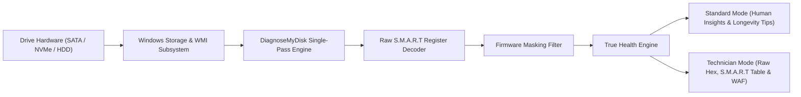

# DiagnoseMyDisk 💾

[](https://creativecommons.org/licenses/by-nc/4.0/)
[](https://microsoft.com/windows)
[](https://github.com/geadalfa/DiagnoseMyDisk/releases/tag/v1.2.0)
[](https://github.com/geadalfa/DiagnoseMyDisk/releases/download/v1.2.0/DiagnoseMyDisk_Setup.exe)

> **DiagnoseMyDisk** is a modern, transparent Windows storage health inspector and deep S.M.A.R.T telemetry diagnostic tool. It eliminates firmware reporting discrepancies, reveals the true endurance of SATA and NVMe SSDs, and presents actionable health insights through intuitive dual perspectives: **Standard Mode** for everyday users and **Technician Mode** for hardware specialists.

### 📥 [Download Official Windows Setup (v1.2.0)](https://github.com/geadalfa/DiagnoseMyDisk/releases/download/v1.2.0/DiagnoseMyDisk_Setup.exe) (~6.6 MB - Zero dependencies)

---

## 🌐 Quick Language Navigation
- [English Documentation](#-english)
- [Dokumentasi Bahasa Indonesia](#-bahasa-indonesia)

---

# 🇬🇧 English

### The Problem It Solves: Firmware Reporting Bias
Certain SATA SSD controllers (e.g., Silicon Motion and budget tier DRAM-less drives) are configured with firmware that locks the normalized **Current** value of S.M.A.R.T health registers at static `100`. Standard disk utilities rely on this normalized field and falsely report **100% Good**, even when underlying flash memory cells are degrading, bad blocks are isolated, and reallocated sectors are accumulating.

**DiagnoseMyDisk** bypasses static firmware normalization by directly inspecting raw hardware registers (such as register `0xA9`, reallocated sectors `0x05`, retired bad blocks `0xA6`, and available spare `0xE8`), calculating the **True Health** of your storage devices deterministically.



### Key Features
1. **Deterministic True Health Calculation:**  
   Detects and unmasks false 100% health reports on SATA SSDs by analyzing raw register endurance values, reallocated sectors, and bad block reserves.
2. **NVMe 2.0 Specification Compliance:**  
   Strictly calculates NVMe health based on NVM Express Log Page 02h (Attribute `05 Percentage Used`) while verifying that physical reserve blocks (`03 Available Spare`) remain intact.
3. **Dual Diagnostic Modes:**  
   - **Standard Mode:** Plain-language explanations of wear factors (power-on time, host writes, drive occupancy stress) and customized hardware longevity tips.
   - **Technician Mode:** Comprehensive S.M.A.R.T table with 3D color-coded status spheres, raw hex values, and write amplification telemetry.
4. **Interactive Capacity Tooltip:**  
   Hover over the partition capacity bar to instantly view `(Used capacity: X GB / Free capacity: Y GB)` with per-partition breakdowns.
5. **Instant Bilingual Support:**  
   One-click toggle between English (`EN`) and Bahasa Indonesia (`ID`) across all interface labels and diagnostic reports.
6. **Ultra-Lightweight & 100% Silent:**  
   Fast single-pass PowerShell/WMI engine runs silently in under ~1.2 seconds without popping command-prompt windows or running background bloatware.
7. **Standalone Portable Installer:**  
   Self-contained Windows setup with zero Python requirements for end-users.

### Installation & Usage
1. Download the latest installer from the [Releases](https://github.com/geadalfa/DiagnoseMyDisk/releases) section: `DiagnoseMyDisk_Setup.exe`.
2. Run the setup wizard to install **DiagnoseMyDisk** to your local user directory (no administrative credentials required).
3. Launch **DiagnoseMyDisk** from your Desktop or Start Menu shortcut.
4. Select any drive from the top disk list to inspect its health status and S.M.A.R.T telemetry.

### Building from Source
```powershell
# Clone the repository
git clone https://github.com/geadalfa/DiagnoseMyDisk.git
cd DiagnoseMyDisk

# Install dependencies (Pillow for icon rendering, PyInstaller for compilation)
pip install -r requirements.txt

# Run locally in development mode
python server.py

# Build standalone Windows executable
pyinstaller --clean --noconfirm --onedir --windowed --name="DiagnoseMyDisk" --icon="app_icon.ico" --add-data="static;static" --add-data="backend;backend" server.py
```

---

# 🇮🇩 Bahasa Indonesia

### Masalah yang Diselesaikan: Bias Pelaporan Firmware
Beberapa controller SSD SATA (seperti controller Silicon Motion dan drive hemat daya tanpa DRAM) memiliki konfigurasi firmware yang mengunci nilai normalisasi **Current** pada register kesehatan S.M.A.R.T di angka statis `100`. Aplikasi pembaca disk standar membaca nilai ini sehingga secara keliru menampilkan **100% Good**, meskipun sebenarnya sel memori NAND sudah aus, bad block bermunculan, dan sektor rusak telah dipindahkan ke memori cadangan.

**DiagnoseMyDisk** membaca langsung register mentah (*Raw Value*) pada chip hardware (seperti atribut `0xA9`, relokasi sektor `0x05`, isolasi bad block `0xA6`, dan sisa cadangan `0xE8`) untuk menghitung **Kesehatan Sebenarnya (True Health)** secara objektif dan deterministik.

### Fitur Unggulan
1. **Deteksi Kesehatan Sebenarnya (True Health):**  
   Membongkar status 100% palsu pada SSD SATA akibat penguncian firmware dan menghitung sisa umur aktual sel memori flash.
2. **Kesesuaian Standar Resmi NVMe 2.0:**  
   Menghitung keausan SSD NVMe secara akurat dari Log Page 02h (Atribut `05 Percentage Used`) serta memverifikasi keutuhan memori cadangan fisik (`03 Available Spare`).
3. **Mode Ganda (Mode Awam & Mode Teknisi):**  
   - **Mode Awam:** Bahasa santai yang mudah dimengerti, penjelasan faktor penyebab penurunan umur disk, serta tips praktis perawatan storage.
   - **Mode Teknisi:** Tabel lengkap parameter S.M.A.R.T dengan bola indikator 3D, nilai hex/desimal mentah, dan telemetri *Write Amplification Factor* (WAF).
4. **Pop-up Interaktif Kapasitas Partisi:**  
   Arahkan kursor (*hover*) ke kapasitas partisi untuk melihat detail kapasitas terpakai dan sisa ruang `(Kapasitas terpakai: X GB / Sisa kapasitas: Y GB)`.
5. **Dukungan Dua Bahasa (ID / EN):**  
   Ganti bahasa secara instan antara Bahasa Indonesia dan Bahasa Inggris langsung dari menu atas.
6. **Eksekusi Senyap & Cepat (~1.2 Detik):**  
   Pemindaian hardware berlangsung di latar belakang secara 100% silent tanpa jendela CMD hitam yang berkedip.
7. **Installer Mandiri (Standalone):**  
   Dapat langsung dipasang di komputer teman tanpa perlu menginstall Python atau dependensi tambahan apa pun.

---

## 📁 Repository Structure
```text
DiagnoseMyDisk/
├── backend/
│   ├── collector.py          # Single-pass Windows Storage & WMI telemetry collector
│   └── smart_decoder.py      # S.M.A.R.T table decoder & True Health calculation engine
├── static/
│   ├── app.js                # Frontend controller & reactive bilingual i18n engine
│   ├── index.html            # Main UI layout (Crystal clean aesthetic)
│   ├── style.css             # Light/Dark themes, 3D spheres, & tooltip styles
│   ├── manifest.json         # Web App Manifest for Windows taskbar icon
│   ├── favicon.ico           # Multi-resolution application icon
│   └── icon-*.png            # App icons (16px, 32px, 192px, 512px)
├── app_icon.ico              # Windows PE executable icon (Floppy disk minimalist)
├── installer.iss             # Inno Setup professional installer script
├── server.py                 # Multi-threaded local server & Edge app mode launcher
├── run.bat                   # Quick launcher script
├── LICENSE                   # Creative Commons Attribution-NonCommercial 4.0 (CC BY-NC 4.0)
└── README.md                 # Project documentation
```

---

## 📄 License & Attribution
Proyek ini didistribusikan di bawah lisensi **Creative Commons Attribution-NonCommercial 4.0 International (CC BY-NC 4.0)**.

- **Non-Commercial:** Anda bebas menggunakan, memodifikasi, dan membagikan aplikasi ini untuk keperluan pribadi, riset, atau edukasi, **namun dilarang keras untuk diperjualbelikan atau dimonetisasi secara komersial**.
- **Attribution:** Harap menyertakan atribusi nama pencipta: `Alfa (geadalfa) & Gemi`.

---
*Created with precision for transparent, honest PC storage diagnostics.*
